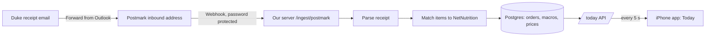

# Pitchfork: what it does and how it works

Working name **Pitchfork** (the repo is still called `thecube`). It's an iPhone app that
coaches a Duke student on eating: what they've eaten today, whether their food points will
last the semester, and what to eat next.

## The one-sentence pitch

Forward your Duke dining receipt and Pitchfork logs the meal with real macros from Duke's
own nutrition data. It checks your points against the semester calendar and tells you what
to eat next.

## The problem

- Duke shows menus and nutrition facts on NetNutrition, and your balance in eAccounts. Nothing
  joins them, so to know "how much protein did I eat" or "will my points last" you do math by
  hand.
- Points run out before finals for a lot of students. You only find out when the balance is low.
- Duke has no public dining API, so no app can just read your purchases.

## What the user sees (3 tabs)

### Today: "How am I doing, and what do I eat?"
Top to bottom:
1. **Coach card.** Two or three sentences about today, e.g. "You're 135 points behind
   pace; at this rate points run out December 9." Gemini writes the sentences, but every
   number in them is computed by our code and checked (see "Rules we hold ourselves to").
2. **Rings.** Protein eaten vs target, and calories vs target (hidden if the user turns
   calories off). Also how many of the last 7 days hit protein.
3. **Eat next.** What this meal should bring ("Last meal today: aim for 76 g protein,
   6.16 pts left today"). Then the app's #1 pick with a one-line reason, and 2 other options
   behind a tap. A switch picks the goal:
   - **Balanced:** closest to what you still need, easy on points.
   - **More protein:** the most protein, even if it costs more.
   - **Cheaper:** the fewest points that still make a real meal.
   Picks respect diet and allergen settings (e.g. halal, no peanut), and only places that are
   open now (or opening within 2 hours).
4. **Points.** Points left, swipes left, daily budget, spent today, 7-day average, run-out
   date, and **Plan pace**: where an even spend of your meal plan would leave you today.
5. **Today's meals.** Each meal with vendor, items, protein, calories and points. Swipe to delete.

Today refreshes every 5 seconds, so a forwarded receipt shows up while you watch.

### The devil, Feeling hungry, Wrapped, widgets
- **Pixel devil** (top-right of every tab): its mood is computed from Today: sleepy before the
  first meal, happy once protein is hit, sweating when behind on points. Tap it for a menu with its one-line
  status and shortcuts to Feeling hungry and Wrapped.
- **Feeling hungry?** Our "I'm feeling lucky": tap or hold the pan (a card on Today, or
  the devil menu), the devil stirs a pot (haptics
  speed up), the lid pops and a meal card flips over with its macros counting up. Swipe left for
  another, right for "Let's go". The cards are the optimizer's picks for all three goals.
- **Wrapped:** a Spotify-style story of the semester so far: dining days, meals, your spot, your
  signature order, protein total (in eggs), hungriest hour, points personality, a share card.
  Code computes every stat; Gemini writes one caption per slide, checked like the coach.
- **Widgets:** lock screen protein ring, points-pace bar and one-line summary; home screen devil
  in its protein ring (small), next pick with an "Another" button (medium), mini Today (large).
- **Onboarding:** 4 screens on first launch: welcome, meal plan + balance, goal/protein/diet,
  and the address to forward receipts to (with a copy button).

### Log: "I ate somewhere without a receipt email"
Pick a vendor, browse its menu by course (macros and diet/allergen tags on each item), add
items, type the points you paid, save. It shows up on Today.

### Settings
Goal (build muscle / maintain / lose), protein and calorie targets, diet and allergen
filters, show calories on/off, meal plan (A–J), and points/swipes balance.

## Where every number comes from

| Number | Source | How |
| --- | --- | --- |
| Macros of a menu item | **Duke NetNutrition** (public site) | Our scraper reads each item's nutrition label, one request per second, cached. 527 items across 9 dining locations. |
| What you ate + what you paid | **Your receipt email** (Duke's mobile-order receipt) | Parsed: vendor, items, toppings, points tender, swipes used, time. |
| Macros of a meal | Code | Each receipt line is matched to a NetNutrition item (aliases + fuzzy match), then summed. If a line can't be matched, the meal is marked **partial**. |
| Points left | Your balance entry, minus spending since | Code. |
| Daily budget | Code | Points left ÷ dining days left in the term. |
| Plan pace | **Duke Registrar Fall 2026 calendar** + the plan's starting balance | Start balance (e.g. Plan A 3,071.28) spread evenly over the 104 days you eat on campus (Aug 24 – Dec 14, skipping fall break and Thanksgiving). Today's "on pace" balance = start − daily × dining days so far. |
| Run-out date | Code | Points left ÷ your 7-day average spend, counted in dining days (breaks skipped). |
| Picks | Code (optimizer) | Every combination on each open menu is scored for the chosen goal; prices are scaled by a typical meal so cost doesn't swamp protein. |
| Coach sentences | **Gemini** | Words only. Given numbers already computed; output rejected if it contains any number not in the input, quotes internal names, or (if calories are off) talks calories. Falls back to a fixed template. |

## How a forwarded receipt becomes a meal

1. The student forwards the receipt to our inbound address (Postmark turns email into a web request).
2. The server parses it: vendor, items, toppings, points and swipes.
3. Each item is matched to its NetNutrition entry to get protein, calories, carbs, fat.
4. The meal is saved (a duplicate forward is ignored), and the price is remembered so picks
   know what things cost.
5. Today picks it up within 5 seconds.

## Architecture

- **iPhone app:** SwiftUI, iOS 27. Talks to the server over HTTPS with a bearer token.
- **Server:** Python FastAPI + Postgres. Modules: receipt parser, matcher, budget/pace,
  optimizer, coach.
- **Data in:** NetNutrition scraper (menus + labels), receipt emails (Postmark webhook),
  manual log, Registrar term dates (a small JSON file).
- **Words:** Gemini (flash-lite), cached per input, validated, with a template fallback.
- **Demo setup:** the server runs on a Mac; a Cloudflare tunnel gives Postmark a public URL;
  the app runs in the iPhone 17 Pro Max simulator.

## The demo student: Blue Devil

A made-up student so the demo has a story. Real menus and prices, invented history:
- Plan A, 839.54 points left, **135 behind an even pace**. At their 30.80/day average, points
  **run out Dec 9, the first day of finals**.
- Goal: build muscle, 150 g protein; 74 g so far today; hit protein 2 of the last 7 days.
- Any receipt forwarded to the app lands on Blue Devil (it's a one-user demo).

## Rules we hold ourselves to

- **Code computes every number; the AI only writes words.** No LLM output feeds any math.
- NetNutrition is scraped politely: one request per second, everything cached.
- No Duke logins, no scraping of eAccounts/Transact. The student brings their own data
  by forwarding receipts.

## What's real vs demo

| Real | Demo / simplified |
| --- | --- |
| NetNutrition menus and macros (527 items) | Blue Devil's order history (generated from real menus and prices) |
| Receipt parsing (31 real receipts all parse) and live email forwarding | One user only; no accounts |
| Registrar Fall 2026 dates, plan starting balances from Duke's chart | Balance is typed in, not read from DukeCard |
| Optimizer, pace, run-out math | Runs on a laptop + tunnel, not a hosted server |

## Brand

Name **Pitchfork** (a devil's pitchfork is also a fork). Logo: "W/U" (WU, Duke's main dining
hall) in Garamond Bold with a code-drawn pitchfork as the slash, on Duke blue
(`design/logo_fork.svg` + `design/make_logo.sh`). Mascot: a 16×18 pixel Blue Devil holding a pitchfork, drawn from
strings in code (`ios/Shared/PixelDevil.swift`), no image assets.
